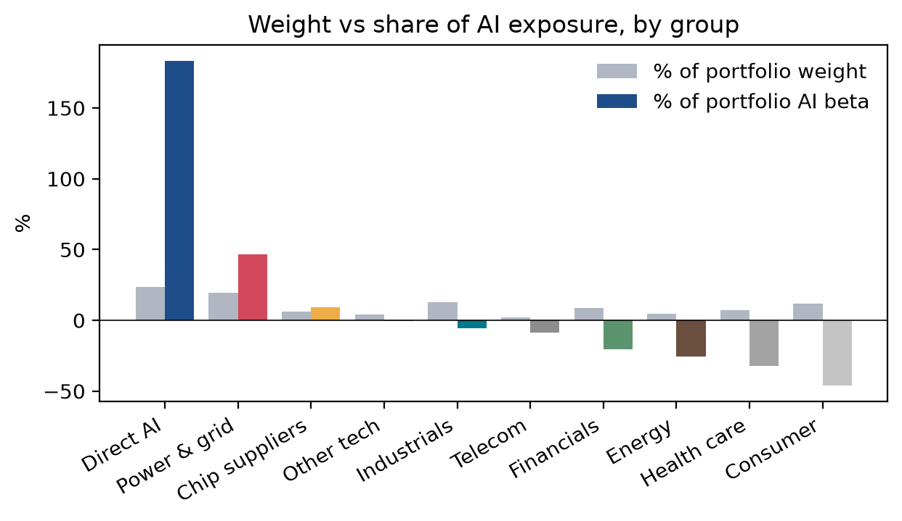

# Hidden AI exposure in a pension portfolio

In October 2026 the UK Pensions Regulator told pension funds to look out for "hidden" AI exposure. The idea is that a portfolio can look well spread across sectors, but still depend quite a lot on the AI theme through companies that aren't AI companies themselves. I got curious if you could actually measure this, so I tried it on a simple Nordic/global stock portfolio.

## What I did

I picked 43 stocks. 9 of them are the big AI names (Nvidia, Microsoft, Alphabet and so on) and the rest are split into groups like power & grid, chip suppliers, industrials, banks and more defensive stocks. I used weekly returns in SEK, mainly from January 2023 since that's roughly when AI became a big market theme after ChatGPT. I also ran it from November 2020 to compare.

To measure AI exposure I made an "AI factor" from the 9 AI stocks and removed the part that is just the market moving. Then I regressed each stock on the market and the AI factor, which gives every stock an AI beta. The portfolio is 40% Nordic and 60% global, equal weighted within each region.

After that I looked at how much of the AI exposure comes from outside the AI stocks, what happened in the DeepSeek sell-off in January 2025, a made-up scenario where AI stocks fall 25% and the market 10%, and whether correlations go up in bad weeks.

## What I found

- Around a quarter of the portfolio's AI exposure comes from stocks that aren't AI companies, mostly US power and data centre suppliers like Vertiv, Constellation and Eaton.
- For Constellation and Eaton the AI beta roughly doubled after 2023 compared to the longer period.
- In the DeepSeek week power & grid stocks fell 8.4%, almost three times more than the AI stocks themselves.
- The correlation between the AI stocks and the rest of the portfolio went from 0.31 in normal weeks to 0.55 in the worst weeks, so diversification works worse exactly when you need it.
- Over the whole period the Nordic stocks had fairly little AI exposure, Atlas Copco being the main exception. But ABB's AI beta has grown a lot, from about -0.2 in early 2024 to about 0.5 over the last year (rolling 52 weeks, see `explore.ipynb`). So the exposure can grow without you changing the portfolio.



## Running it

```
pip install -r requirements.txt
python run.py
```

## Limitations

The betas are based on history and the AI theme has moved fast, so they might look different in a year. The results also depend on which stocks I put in the AI basket. And there are only around 20-30 really bad weeks in the data, so the stress correlations are pretty uncertain. The rolling betas are noisy as well, one extreme week like DeepSeek can move them a lot when it enters or leaves the window.